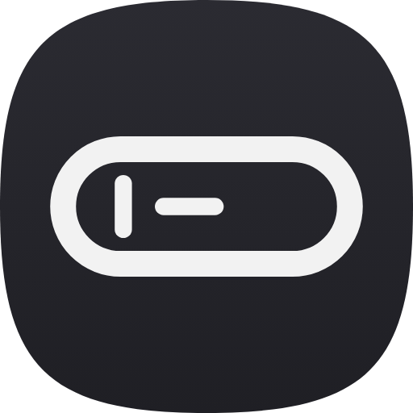
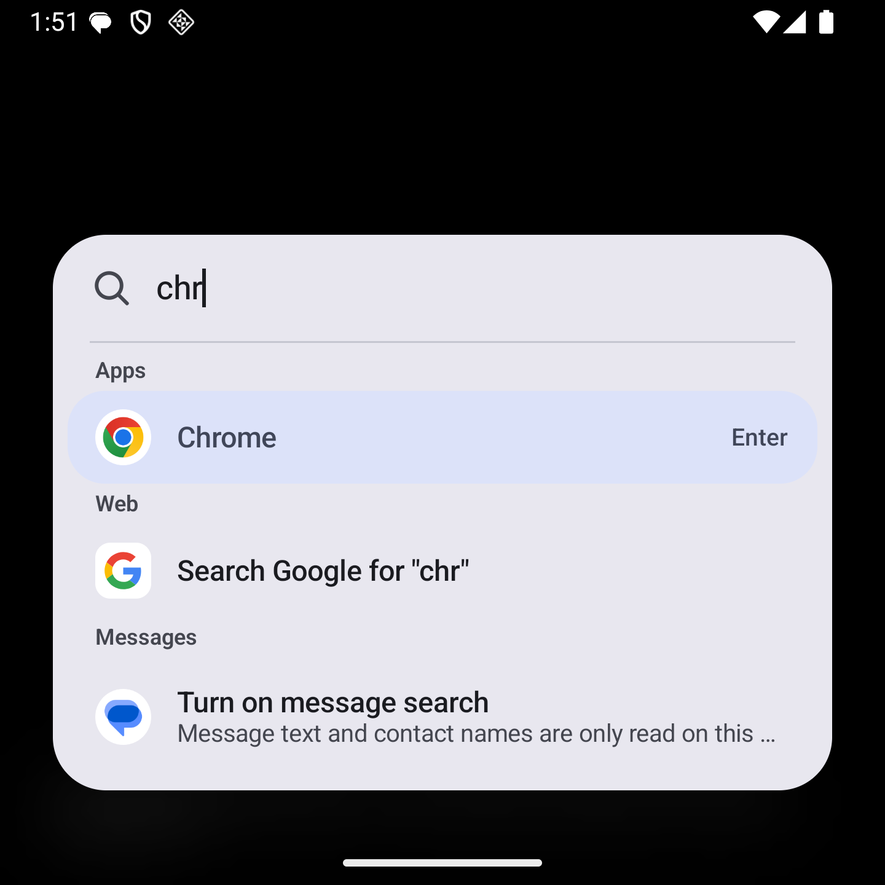
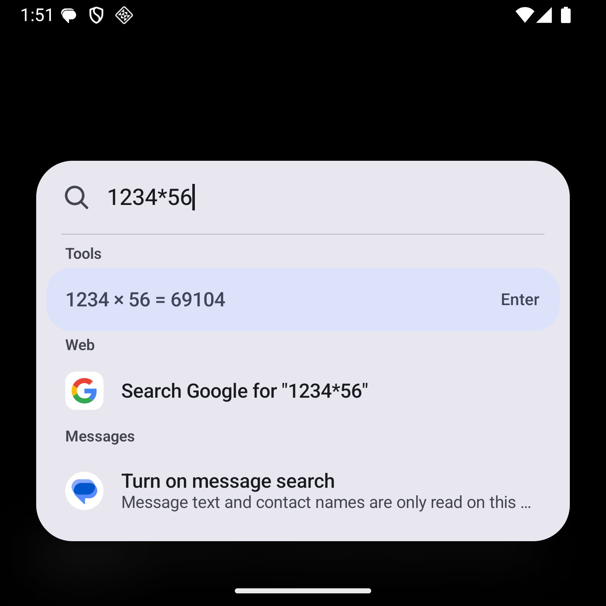
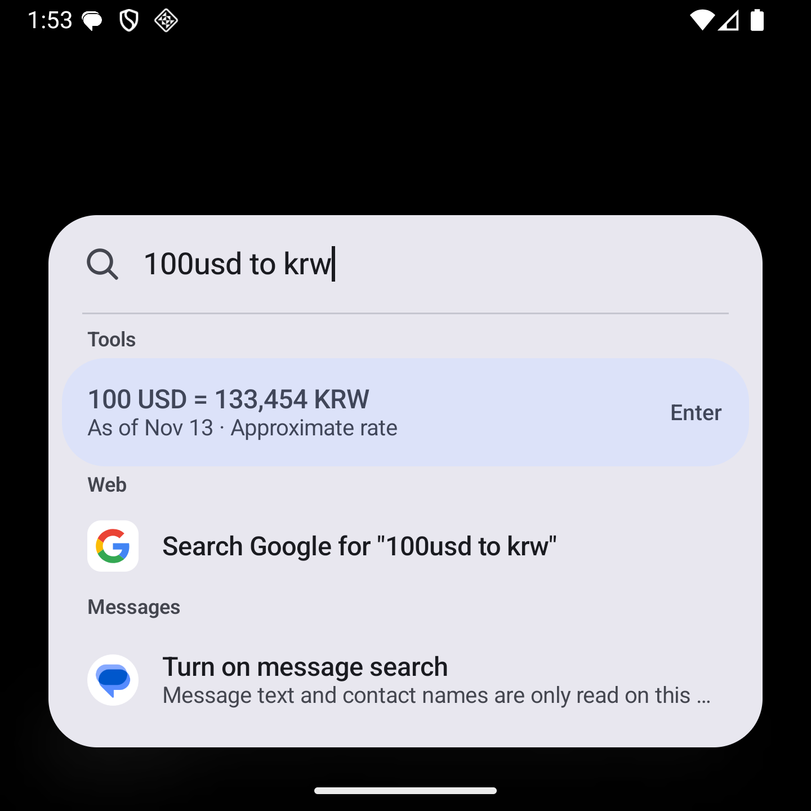
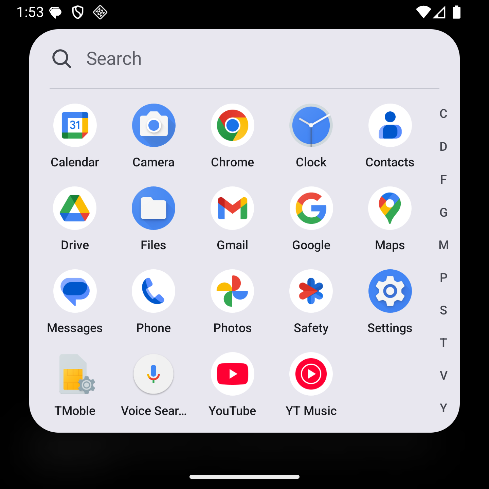

# Q Search Launcher

[한국어](#한국어) · [English](#english)

## 한국어

물리 쿼티 키보드가 달린 안드로이드 폰에서 쓰려고 만든 홈 런처입니다. macOS Spotlight처럼 단축키로 검색창을 열고,
글자를 치고, 엔터를 누르면 됩니다. 앱 실행, 계산, 단위 변환, 환율, 문자 검색, 웹 검색을 한 입력창에서 합니다.

키보드가 없는 폰에서도 터치로 다 쓸 수 있습니다. Titan 2 같은 1:1 정사각 화면과 일반 폰 화면 둘 다 맞춰 그립니다.
아직 다듬는 중인 개인 프로젝트이고, 모든 기능을 무료로 씁니다.

### 기능

검색
- 직접 정한 키 조합(예: Ctrl+Space)으로 검색창을 엽니다. 홈에서뿐 아니라 다른 앱을 쓰는 중에도 열 수 있습니다(접근성 서비스를 켜야 함). 빠른 설정 타일로도 엽니다.
- 앱 이름은 앞 몇 글자나 한글 초성만 쳐도 찾습니다. `ㅋㅋㅇㅌ`를 치면 카카오톡이 나옵니다. 자주 여는 앱이 위로 옵니다.
- `1234*56` 같은 계산과 `3kg to lb` 같은 단위 변환은 치는 동안 답이 나옵니다.
- `100usd`, `$100`, `1000엔`, `100usd to krw`처럼 치면 통화를 바꿔 줍니다. 원화·달러·엔화와 통화 12개를 더 지원하고, 기준 통화를 고를 수 있습니다.
  설정에서 켜야 하고 기본은 꺼져 있습니다.
- 문자 본문을 찾아서 그 대화로 바로 갑니다. 권한을 줘야 하는 선택 기능입니다.
- 결과 맨 아래에 Google과 Play 스토어 검색이 붙습니다. 일치하는 결과가 없으면 Enter가 곧 Google 검색입니다.
- 검색창은 화면 위나 아래에 둘 수 있습니다. 빈 검색창은 백스페이스를 두 번 눌러야 닫힙니다.

홈
- 아래는 4열 즐겨찾기, 위는 위젯 자리입니다. 빈 곳을 길게 누르면 위젯 추가, 배경화면, 설정 메뉴가 나옵니다.
- 위젯은 한 칸에 하나씩 쌓고, 길게 눌러 끌어 순서를 바꿉니다. 위젯을 겹쳐 좌우로 넘겨 보는 위젯 스택도 됩니다.
- 읽지 않은 알림이 있는 앱 옆에 점을 찍습니다.
- 제스처: 배경화면만 보기, 빈 곳 두 번 탭으로 화면 잠금, 두 손가락으로 아래로 밀어 알림창 내리기.
- 테마는 머티리얼(Android 12 이상은 시스템 색), 글래스, 클래식 쿼티 중에서 고릅니다. 아이콘 팩도 씁니다.
- 즐겨찾기, 숨긴 앱, 설정을 파일 하나로 내보내고 되돌릴 수 있습니다.
- 화면 문구는 시스템 언어를 따릅니다. 한국어, 영어, 일본어를 지원하고 그 밖의 언어는 영어로 나옵니다.

앱 서랍
- 가나다순이고, 오른쪽 초성 막대를 밀었다가 놓으면 그 앱이 바로 열립니다.
- 앱을 길게 누르면 앱 정보, 즐겨찾기, 숨기기, 삭제, 앱 바로가기가 나옵니다.

### 설치

Android 8.0 이상에서 동작합니다.

1. [Releases](../../releases)에서 APK를 받아 설치합니다.
2. 홈 버튼을 누르고 Q Search를 기본 홈으로 고릅니다. 바꾼 뒤에는 한 번 재부팅해 주세요. 안 하면 뒤로가기 제스처가 잠깐 멈출 수 있습니다.
3. 처음 열면 검색 단축키를 정하라고 나옵니다. 키보드가 없으면 건너뛰면 됩니다.
4. 다른 앱 위에서도 단축키로 검색창을 열려면 설정 → 다른 앱에서 열기 → 단축키로 열기를 켜고 안내대로 접근성 서비스를 켭니다. 안 켜도 홈 안의 검색은 그대로 됩니다.

설치할 때 "기기 보호를 위해 앱 차단됨"이 뜰 수 있습니다. Play 프로텍트는 브라우저나 파일 앱으로 받은 앱이
문자나 알림 접근 권한을 요청하면 막는데, 이 앱이 둘 다 씁니다. 이럴 때는 아래 둘 중 하나로 설치합니다.

- PC에서 `adb install QSearchLauncher-<버전>.apk`
- Play 스토어 → 프로필 → Play 프로텍트 → 설정에서 "Play 프로텍트로 앱 검사"를 잠시 끄고 설치한 뒤 다시 켜기

### 권한과 개인정보

모든 권한은 선택입니다. 안 줘도 나머지 기능은 그대로 됩니다. 개발자는 사용자의 어떤 데이터도 받지 않습니다.
문자, 연락처, 알림, 키 입력은 기기 안에서만 쓰고, 인터넷은 환율표를 받을 때만 씁니다.

| 권한 | 어디에 쓰나 |
|---|---|
| 문자, 연락처 읽기 | 문자 본문 검색과 보낸 사람 이름 표시. 검색할 때만 읽고 저장하지 않습니다. |
| 알림 접근 | 즐겨찾기의 알림 점. 어느 앱에 알림이 있는지만 봅니다. |
| 접근성 서비스 | 다른 앱 위에서 검색 단축키 받기. 키 입력을 단축키와 비교만 하고 저장하거나 보내지 않으며, 화면 내용은 읽지 않습니다. 설정에서 직접 켜야 동작합니다. |
| 인터넷 | 환율표 받기. 환율 변환을 켰을 때만, 하루 한 번, 정해진 주소 하나로 요청합니다. 입력한 내용은 보내지 않습니다. |
| 빠른 설정 타일 | 알림창 타일로 검색창 열기 |
| 상태 표시줄 펼치기 | 두 손가락으로 아래로 밀어 알림창 내리기 |
| 앱 삭제 요청 | 길게 누르기 메뉴의 "삭제". 시스템 삭제 확인창을 띄우기만 합니다. |

자세한 내용은 [docs/PRIVACY.md](docs/PRIVACY.md)에 있습니다.

### 공개한 코드

앱 전체 소스는 공개하지 않습니다. 대신 위 권한 표에 적은 내용을 코드로 확인할 수 있도록, 데이터를 다루는 코드만 이 저장소에 올렸습니다.

| 확인할 것 | 코드 |
|---|---|
| 문자와 연락처를 어떻게 읽고, 저장하지 않는지 | [`provider-sms/`](provider-sms), [`SmsSearchProvider.kt`](app/src/github/java/io/github/wuugi/qsearch/search/providers/SmsSearchProvider.kt) |
| 네트워크를 쓰는 곳이 환율 요청 하나뿐인지 | [`provider-fx/`](provider-fx), [`FxRepository.kt`](app/src/main/java/io/github/wuugi/qsearch/data/fx/FxRepository.kt) |
| 알림에서 무엇을 보는지 | [`UnreadDotListenerService.kt`](app/src/main/java/io/github/wuugi/qsearch/notification/UnreadDotListenerService.kt) |
| 접근성 서비스가 키 입력으로 무엇을 하는지 | [`paid/.../global/`](paid/src/main/kotlin/io/github/wuugi/qsearch/global), [서비스 선언](paid/src/main/res/xml) |
| 백업 파일에 무엇이 들어가고 어디에 쓰는지 | [`BackupContract.kt`](app/src/main/java/io/github/wuugi/qsearch/data/backup/BackupContract.kt), [`paid/.../data/backup/`](paid/src/main/kotlin/io/github/wuugi/qsearch/data/backup) |
| 앱이 선언한 권한과 구성요소 | [`app/src/main/AndroidManifest.xml`](app/src/main/AndroidManifest.xml), [`paid/src/main/AndroidManifest.xml`](paid/src/main/AndroidManifest.xml), 각 모듈의 매니페스트 |

이 저장소만으로는 앱을 빌드할 수 없습니다. 받은 APK의 실제 권한과 구성요소는 Android SDK의 `aapt dump permissions <APK>`로 확인할 수 있습니다.

### 알려진 문제

- 홈 제스처로 앱을 닫으면 즐겨찾기에 있는 앱만 그 타일로 줄어듭니다. 다른 앱은 화면 아래쪽으로 줄어듭니다.
- 문자 검색은 RCS 채팅과 카카오톡 같은 메신저를 찾지 못합니다. 그룹 MMS는 1:1 대화로 열립니다.
- 위젯을 추가할 때 시스템이 "위젯 만들기 허용" 확인창을 띄웁니다. 서드파티 런처는 이 확인 없이 위젯을 붙일 수 없습니다.
- Titan 2 실기기에서는 아직 확인하지 못했습니다. 에뮬레이터와 Motorola edge 70(Android 16)에서 확인했습니다.

홈이 계속 꺼지는 등 문제가 생겼을 때 원래 런처로 돌아가는 방법은 [docs/RECOVERY.md](docs/RECOVERY.md)에 있습니다.

### 문의

버그와 제안은 이슈로 받습니다. 풀 리퀘스트는 받지 않습니다.

### 라이선스

이 저장소에 공개한 파일은 [GPL-3.0](LICENSE)입니다. 앱 전체는 오픈소스가 아니며, 릴리스 APK는 무료로 배포합니다.
환율 데이터는 [Frankfurter](https://frankfurter.dev)(유럽중앙은행 기준)에서 받습니다.

---

## English

A home launcher for Android phones with a physical QWERTY keyboard. Like macOS Spotlight, you press a shortcut to
open a search box, type, and press Enter. Launching apps, math, unit and currency conversion, SMS search and web
search all happen in that one box.

It also works with touch on phones without a keyboard, and lays itself out for both 1:1 square screens (like the
Titan 2) and regular phone screens. It is a personal project that is still being polished, and every feature is free.

### Features

Search
- Open the search box with a key combo you pick, e.g. Ctrl+Space, on the home screen and over other apps too (needs the accessibility service). A Quick Settings tile opens it as well.
- Find apps by typing the first few letters (or Korean initial consonants). Apps you open often come first.
- Math like `1234*56` and units like `3kg to lb` are answered as you type.
- Currency: `100usd`, `$100`, `100usd to krw`. KRW, USD, JPY and 12 more currencies, with a base currency you choose. Off by default; turn it on in settings.
- Optional SMS body search that opens the matching conversation.
- Google and Play Store search rows sit at the bottom of the results. With no match, Enter goes straight to Google.
- Keep the search box at the top or bottom of the screen. An empty search box closes on the second Backspace.

Home
- A 4-column favorites grid below and a widget area above. Long-press an empty spot for add widget, wallpaper and settings.
- One widget per slot, reordered by long-press and drag. Widget stacks let you layer widgets and swipe through them.
- A dot on apps with unread notifications.
- Gestures: wallpaper only, double-tap to lock the screen, two-finger swipe down for the notification shade.
- Material (system colours on Android 12+), Glass and Classic QWERTY themes. Icon packs are supported.
- Export favorites, hidden apps and settings to one file and restore them.
- The UI follows the system language: English, Korean or Japanese (anything else falls back to English).

App drawer
- Alphabetical, with an index bar on the right. Slide to a letter and release to open an app.
- Long-press an app for app info, favorite, hide, uninstall and its shortcuts.

### Install

Requires Android 8.0 or newer.

1. Download the APK from [Releases](../../releases) and install it.
2. Press Home and choose Q Search as the default home app. Reboot once after switching, or the back gesture may stall briefly.
3. On first launch you'll be asked to set a search shortcut. Skip it if you have no keyboard.
4. To open search with the shortcut over other apps, turn on Settings → Open from other apps → Open with shortcut and follow the steps to enable the accessibility service. Search on the home screen works without it.

You may see "App blocked to protect your device". Play Protect blocks apps installed from a browser or file manager
when they ask for SMS or notification access, and this app uses both. Install it one of these ways:

- From a PC: `adb install QSearchLauncher-<version>.apk`
- Play Store → profile → Play Protect → settings, turn off "Scan apps with Play Protect", install, then turn it back on

### Permissions and privacy

Every permission is optional. Deny one and everything else keeps working. The developer receives none of your data.
SMS, contacts, notifications and key presses are used only on the device, and the internet is used only to download exchange rates.

| Permission | Used for |
|---|---|
| Read SMS, read contacts | SMS body search and sender names. Read only while searching, never stored. |
| Notification access | Unread dots on favorites. It only looks at which apps have notifications. |
| Accessibility service | Catching the search shortcut over other apps. Key presses are only compared with your shortcut, never stored or sent, and screen content is never read. It works only after you turn it on in settings. |
| Internet | Downloading the exchange rate table. Only when currency conversion is on, about once a day, to one fixed address. Nothing you type is sent. |
| Quick Settings tile | Opening search from a notification-shade tile |
| Expand status bar | Two-finger swipe down for the notification shade |
| Request uninstall | "Uninstall" in the long-press menu. It only opens the system confirmation dialog. |

Details are in [docs/PRIVACY.md](docs/PRIVACY.md) (Korean).

### Published code

The app's full source is not published. This repository holds the code that handles your data, so you can check the permission table above against it.

| What to check | Code |
|---|---|
| How SMS and contacts are read, and that they are not stored | [`provider-sms/`](provider-sms), [`SmsSearchProvider.kt`](app/src/github/java/io/github/wuugi/qsearch/search/providers/SmsSearchProvider.kt) |
| That the only network use is the exchange rate request | [`provider-fx/`](provider-fx), [`FxRepository.kt`](app/src/main/java/io/github/wuugi/qsearch/data/fx/FxRepository.kt) |
| What is read from notifications | [`UnreadDotListenerService.kt`](app/src/main/java/io/github/wuugi/qsearch/notification/UnreadDotListenerService.kt) |
| What the accessibility service does with key presses | [`paid/.../global/`](paid/src/main/kotlin/io/github/wuugi/qsearch/global), [service declaration](paid/src/main/res/xml) |
| What goes into a backup file and where it is written | [`BackupContract.kt`](app/src/main/java/io/github/wuugi/qsearch/data/backup/BackupContract.kt), [`paid/.../data/backup/`](paid/src/main/kotlin/io/github/wuugi/qsearch/data/backup) |
| The permissions and components the app declares | [`app/src/main/AndroidManifest.xml`](app/src/main/AndroidManifest.xml), [`paid/src/main/AndroidManifest.xml`](paid/src/main/AndroidManifest.xml), and each module's manifest |

This repository cannot build the app on its own. You can check the real permissions and components of the APK you downloaded with `aapt dump permissions <APK>` from the Android SDK.

### Known issues

- Closing an app with the home gesture shrinks it into its tile only if the app is a favorite. Other apps shrink toward the bottom of the screen.
- SMS search can't see RCS chats or third-party messengers. Group MMS opens as a 1:1 conversation.
- Adding a widget shows the system "allow widget access" dialog. Third-party launchers can't bind widgets without it.
- Not yet tested on a real Titan 2. Tested on emulators and a Motorola edge 70 (Android 16).

If the launcher keeps failing and you need your old launcher back, see [docs/RECOVERY.md](docs/RECOVERY.md) (Korean).

### Feedback

Bugs and suggestions are welcome as issues. Pull requests are not accepted.

### License

The files published in this repository are [GPL-3.0](LICENSE). The app as a whole is not open source; the release APK is free.
Exchange rates come from [Frankfurter](https://frankfurter.dev) (European Central Bank data).
